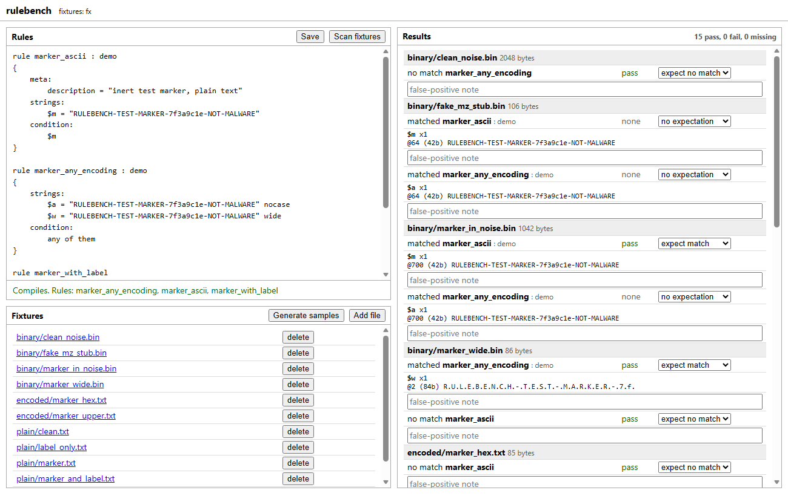

# rulebench

A small local playground for YARA rules. You edit a rule, it compiles as you type
(with the error location), and you scan a directory of fixture files to see which
rules and strings matched, at what offsets. You can mark per rule/fixture whether a
match is expected, and the tool shows pass/fail, so a rule set doubles as a tiny
regression suite. There is a CLI mode for CI.

It uses [YARA-X](https://github.com/VirusTotal/yara-x) (`yara-x` on PyPI), which
ships a wheel for Python 3.14 on Windows. The UI is one static HTML page served by
the stdlib `http.server` on 127.0.0.1, no external assets.



## Usage

```
pip install -e .[dev]

python -m rulebench gen fixtures
python -m rulebench serve fixtures --rules examples/markers.yar
```

Open http://127.0.0.1:8470/. Scan, then set "expect match" / "expect no match" per
rule and fixture in the results, and type false-positive notes under a match.
Expectations and notes live in `rulebench.db` (SQLite, current directory; change
with the global `--db`).

CI mode:

```
python -m rulebench check examples/markers.yar fixtures --expect examples/expect.json
```

Prints PASS/FAIL per annotated pair and exits 1 on any failure or missing fixture,
2 if the rules don't compile. `--expect` merges a JSON file
(`{"rule": {"path/in/fixtures": true}}`) into the db first; `python -m rulebench export`
dumps what the db holds in that format.

The `gen` command writes about a dozen small synthetic files containing an invented
marker string (plain, UTF-16, upper-cased, hex-encoded, buried in random bytes, a
one-character decoy). Nothing in them is real malware or resembles it.

## Notes

Fixtures are only read as bytes and handed to the scanner; nothing is run. The
server binds to 127.0.0.1, rejects requests whose Host header isn't
localhost/127.0.0.1 on its port, and only accepts JSON POSTs. All fixture access
goes through one resolver that rejects absolute paths, `..`, drive prefixes, `:`,
Windows device names (`con`, `nul`, `com1`...) and anything resolving outside the
directory given at startup. Symlinks are not listed or followed.

What it doesn't do:

- One rule file at a time; no imports of other files, no external variables.
- Only tested against yara-x; rules written for libyara may differ in small ways.
- The editor is a plain textarea with no highlighting. Errors are listed below it,
  and clicking one selects the span.
- Files over 32 MiB are skipped, and hits are capped at 50 per pattern.
- No auth. It only listens on loopback because of that.
- The symlink test is skipped when the OS won't create symlinks (it was skipped
  on the Windows machine this was written on).
- Expectations are keyed by rule name, so same-named rules in different files
  share them.
